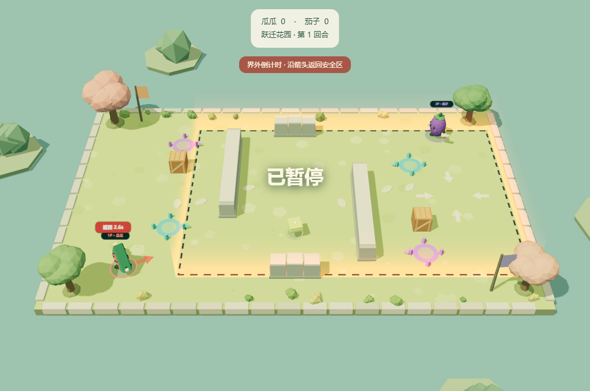
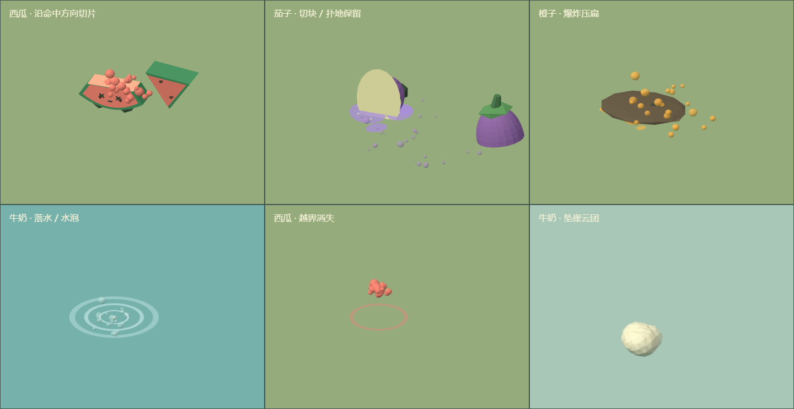

# 第三阶段验收：矩形缩圈与死亡反馈

日期：2026-10-28。验证环境：Windows、Node 24.21.0、桌面 Chrome/WebGL 2。原版未启动；机制依据来自安装文件的静态 CIL 和 Unity 序列化资源，不能据此声称实机手感或逐帧画面一致。

## 实现结果

- 原中心圆形即死圈改为移动的矩形边界。默认 180 秒、原版资源 Hermite 曲线、最终 4×4 Web 单位；菜单可选 30/60 秒体验。移除 65 秒强制回合结束。
- 进入圈外给予 3 秒、收缩中进入给予 3.75 秒宽限，回内清除。地面虚线、渐变侧墙、四个目标箭头、人物闪烁与个人返回倒计时均读取同一权威状态。
- 五种持久死亡记录驱动切片/扑地、爆炸压扁、落水水花水泡、悬崖云团、界外爆散。主切块留至回合结束，贴花按时退场；渲染晚挂载不需要重放历史死亡事件。
- 水/崖下落分别为 0.66/0.74 秒，前 0.33 秒可在普通冷却允许时冲刺救回一次，着地重置。最后一名下落角色不能提前获胜。
- 淘汰后继续模拟 1.45 秒再核对胜负，后续死亡重启确认。武器/爆炸维持 0.1 秒停帧；五种死因使用分别合成的音效，缩圈提示仅在开始时播放一次。
- SDK 0.3.0 公开边界、下落、死亡记录、缩圈选项及 `boundary` 事件；主站与嵌入组件共用渲染和告警文案。

## 检查结果

| 检查 | 本次结果 |
| --- | --- |
| `npm test -- --silent` | 12 个测试文件，131/131 通过 |
| TypeScript + `npm run build` | 通过；Vite 提示 Three.js 公共块超过 500 kB，未阻止构建 |
| `npm run format:check` | 通过 |
| `npm run test:browser` | 17 项通过：五图、实际键盘、传送、暂停、自然回合轮换、960×640 菜单 |
| `npm run test:sdk-browser` | 10 项通过：外控、真实投掷、脚本/键盘接管、多实例与销毁 |
| `npm run test:v3-browser` | 9 项综合检查通过，15 张截图；真实流程与隔离呈现样本分开记录 |
| `node scripts/production-smoke.mjs` | 正式主站与 SDK 演示通过，无开发 hook、无外部请求或浏览器错误 |
| `npm run build:sdk` / `npm run verify:sdk` | 独立 tarball 安装、无 DOM 核心、NodeNext 类型、完整五分对局和 Chrome 消费通过 |

原先 `flow.test.ts` / `match.test.ts` 中“击杀当帧已得分”的断言改为检查确认期零分、停帧不减少确认期、确认后仅得一次分；保留了换图、计分及自然整场的回归断言。

## 浏览器证据的范围

`scripts/v3-browser-verify.mjs` 使用公开 `createBrowserGame`、比赛选项、控制器、pause/start/destroy；自然 RAF 推进时不额外调用 step、不修改内部状态。显式设置 `suddenDeathTime:1` 缩短验收等待，生产默认仍为 180 秒。检查自然矩形收缩、出界告警、暂停冻结、超时界外死亡及其状态/事件一致、重开清空危险状态和销毁后 RAF 停止。

逃回安全区检查仅用公开 `useScript` 移动：tick 490→572，角色从 (-9,5.5) 到约 (-1.4696,4.1025)，仍存活且 `outOfBounds` 已清除。回场箭头的几何世界方向与目标方向点积约为 1。

另有独立呈现 fixture 将构造状态交给渲染器，验证矩形与箭头、五种死亡画面、反向时间采样、晚挂载、死者无敌标记不使身体重现、12 次 reset 后 GPU 几何/纹理保持 403/3。它证明显示与清理行为，不替代实际战斗碰撞；真实攻击/爆炸/下落判定由纯模拟测试和既有公开控制/键盘检查支持。

本地详尽记录为 `test-results/v3-feedback/report.json`，含源码 SHA-256、检查条目、截图路径、零浏览器错误与源码未变化检查；SDK 记录为 `test-results/sdk-package/verification.json`。原 15 场景计划包含更广的五图多尺寸、长跑及实机对照，本次并未逐项执行整张矩阵；不能将综合检查数量当成所有原版行为已经覆盖。

## SDK 交付

`dist-sdk/boomerang-garden-sdk-0.3.0.tgz`：66,138 字节，43 个文件。

SHA-256：`daf5b0075594c862bbc33712fd1d675c11496bc7be0c984774818da7414328f9`。

独立安装验证核对了源码哈希及包内 API 文档，真实执行矩形缩圈、持久死亡、暂停、重开清理，并通过完整 5 分机器人对局（6,990 tick，最终比分 2:5）。Chrome 从已安装文件通过 import map 加载，外控移动、脚本移动、D/S 键人工接管、恢复脚本、暂停和销毁均通过，frameErrors/listenerErrors 为 0。仓库 `dist-sdk.zip` 已更新且验证内含 tarball 的哈希一致。未发布 npm、未对外部署站点。

## 保留差异

Web 地图仍为原创布局、仅轴对齐边界，未实现旋转 Box、缩圈强化、多种胜利模式或全部角色/道具。边界色彩与亮度、中心回场箭头、阿拉伯数字倒计时、自建切块、解析碎片轨迹、合成音效均为 Web 适配；原版回场箭头朝最近边缘，原版链路不直接显示数字倒计时。切片不参与 Unity 原版碎片碰撞，牛奶持续倒液、湿滑地面、完整下落惯性、慢动作/最后击杀变焦仍未完整实现。

当前短音效已开始的尾音可在暂停或重开后自然结束，最长约 0.74 秒；没有新增循环警报或异步延迟游戏回调。销毁关闭 AudioContext。原版研究出处见 [缩圈](sudden-death-analysis.md)、[死亡反馈](death-feedback-analysis.md)与[资源审计/测试计划](v3-feedback-test-plan.md)。
